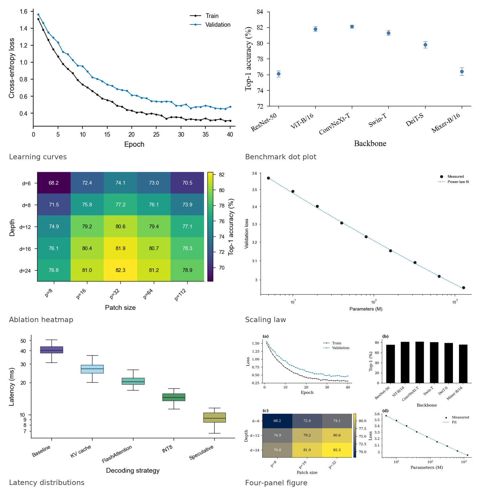

<div align="center">



# figspec

**Figures as code: declarative, journal-compliant, reproducible.**

[](https://github.com/sw176267788/FigSpec/actions/workflows/ci.yml)
[](https://sw176267788.github.io/FigSpec/)
[](pyproject.toml)
[](LICENSE)
[](CHANGELOG.md)

[English](README.md) · [简体中文](README.zh-CN.md)

</div>

A figure is a build artefact, but most labs still treat it as a file somebody
tweaked by hand. **figspec** compiles a small YAML file into submission-ready
figures: it knows how wide a Nature single column is, how small a 5 pt label
renders, and which colour pairs disappear for colour-blind readers — so you do
not have to re-learn that for every journal.

```bash
figspec render figure.yaml -o figures     # → figures/figure.{pdf,svg,png}
figspec lint   figure.yaml --journal nature
figspec verify figures/figure.figspec.json
```

> **Status:** v0.1.0 (alpha). The spec, renderer, linter, manifest and CLI are
> usable and covered by 138 tests. The public API may change in minor releases
> until v1.0. Roadmap below.

## Contents

- [Why figspec](#why-figspec)
- [Features](#features)
- [Installation](#installation)
- [Quick start](#quick-start)
- [The spec format](#the-spec-format)
- [Journal presets](#journal-presets)
- [Linting](#linting)
- [Reproducible builds](#reproducible-builds)
- [CLI](#cli)
- [Python API](#python-api)
- [Repository layout](#repository-layout)
- [How it compares](#how-it-compares)
- [Roadmap](#roadmap)
- [Contributing](#contributing)
- [Citation](#citation)
- [License](#license)

## Why figspec

If you have prepared a paper, you have met these:

- **Every journal wants different numbers.** Column width, font size, line weight
  and DPI live in a submission guide nobody reads until revision. A figure that
  looked fine at 5 inches is unreadable at 3.5.
- **"The same plot" is never the same file.** Re-running a notebook with updated
  matplotlib defaults produces a visually similar figure and an entirely
  different file, so nobody can prove which one is in the PDF.
- **Colour fails silently.** About 8% of men cannot separate red from green, and
  pale hues vanish in print or greyscale.
- **Figures drift from their data.** Six months later, no one knows which CSV or
  which commit produced panel (c).

figspec treats all four as engineering problems: a schema, a compiler, a linter
and a manifest.

## Features

- **Declarative specs.** Size, axes, series, legends, annotations and panel
  layout live in one YAML/JSON file — diffable, reviewable, generatable.
- **8 journal presets.** Nature, Science, Cell, IEEE, ACM, Elsevier, Springer and
  PLOS, plus `--journal-file` for your own.
- **18 lint rules.** Minimum type size at final print size, stroke weights, WCAG
  contrast, colour-vision separation (CIEDE2000 on simulated dichromacy), DPI,
  legends, axis labels, rainbow colormaps and truncated bar axes.
- **Byte-reproducible output.** PDF, SVG, PNG and EPS are identical across runs in
  the same environment; timestamps and random ids are stripped.
- **Provenance manifests.** Input hashes, versions, output hashes and git state
  recorded on every build; `figspec verify` detects drift.
- **Multi-panel figures.** Explicit or automatic grids, shared axes, `(a)`–`(d)`
  labels, per-panel legends.
- **CI-ready.** `--strict`, `--fail-on`, JSON and SARIF 2.1.0 output turn figure
  quality into a build gate.
- **Library first.** The CLI is a thin shell over a typed Python API.

## Installation

figspec is not on PyPI yet. Install from the repository:

```bash
pip install "git+https://github.com/sw176267788/FigSpec.git"
```

or work on a clone:

```bash
git clone https://github.com/sw176267788/FigSpec.git
cd FigSpec
python -m venv .venv
# Windows: .venv\Scripts\activate    macOS/Linux: source .venv/bin/activate
pip install -e ".[dev]"
pytest -q
```

Requires **Python 3.10+** and matplotlib 3.7+. Runtime dependencies are
matplotlib, numpy, PyYAML and click. No LaTeX, no browser, no network access.

## Quick start

```bash
figspec init my-paper                     # figure.yaml + data/loss.csv
figspec render my-paper/figure.yaml -o figures
figspec lint   my-paper/figure.yaml --journal nature
```

`render` reports what it wrote, what the linter thought, and where the manifest
is:

```
  [ok] figure.pdf                23.1 KiB
  [ok] figure.svg                28.6 KiB
  [ok] figure.png               135.6 KiB
rendered 3 file(s) in 0.72s
lint: clean
provenance: figures/figure.figspec.json
```

## The spec format

```yaml
version: 1

meta:
  title: Training and validation loss
  tags: [deep-learning, training]

figure:
  journal: nature        # column grid, fonts, DPI and minimum sizes come from here
  layout: single         # single | 1.5 | double | custom
  formats: [pdf, svg, png]

style:
  palette: okabe-ito     # colour-blind safe; first five colours clear 3:1
  grid: true

axes:
  x: {label: Epoch, limits: [0, 41]}
  y: {label: Cross-entropy loss}

series:
  - type: line
    data: data/loss.csv
    x: epoch
    y: [train, val]
    labels: [Train, Validation]
    marker: o
    markersize: 2.2
```

Seven series types: `line`, `scatter`, `bar`, `box`, `errorbar`, `area` and
`heatmap`. Data comes from CSV, TSV, JSON, `.npy`/`.npz`, or inline arrays.
Specs can share a base through `extends` and read `${ENV}` variables.

The complete reference — every key, every default — is in
**[docs/spec-reference.md](docs/spec-reference.md)**.

## Journal presets

| Preset | Single column | Double column | Font (min) | Raster DPI |
|---|---|---|---|---|
| `nature` | 3.504 in | 7.205 in | 7 (5) pt | 600 |
| `science` | 2.165 in | 7.244 in | 6 (5) pt | 300 |
| `cell` | 3.346 in | 6.850 in | 6 (5) pt | 300 |
| `ieee` | 3.500 in | 7.160 in | 8 (6) pt | 300 |
| `acm` | 3.330 in | 7.000 in | 8 (6) pt | 300 |
| `elsevier` | 3.543 in | 7.480 in | 8 (6) pt | 300 |
| `springer` | 3.307 in | 6.850 in | 8 (6) pt | 300 |
| `plos` | 3.270 in | 6.810 in | 8 (6) pt | 300 |

```bash
figspec journals          # table
figspec journals --json   # machine readable, with source URLs
```

Adding a preset is one YAML file; see [docs/journals.md](docs/journals.md).

## Linting

`figspec lint` builds the figure, inspects the materialised artists and reports
findings with stable codes. An example of what it catches:

```
figure.yaml: 1 error(s), 1 warning(s), 0 note(s)
  ERROR   FS001 2 text elements render at 4.0 pt, below the 5.0 pt minimum
          hint: raise font_size, shorten tick labels, or drop the label 'validation split'
  WARNING DA003 panel 0 bars start at 50 instead of zero
          hint: set the y limit to 0, or switch the series to 'errorbar'
```

| Area | Codes | Examples |
|---|---|---|
| Typography | `FS001`–`FS004` | type smaller than the journal minimum, hairlines, width off the column grid |
| Colour | `CO001`–`CO004` | contrast under 3:1, pairs that collapse under dichromacy, rainbow maps |
| Structure | `ST001`–`ST007` | raster-only output, DPI too low, missing legend or axis labels |
| Data | `DA001`–`DA003` | missing values, duplicate labels, truncated bar axes |

Reports come as text, JSON or SARIF 2.1.0, so CI and code scanning can consume
them. The rationale for each rule is in [docs/lint-rules.md](docs/lint-rules.md).

## Reproducible builds

Every build writes `<stem>.figspec.json` next to the outputs, recording the spec
hash, every input file's SHA-256, output hashes and DPI, tool versions, and the
git commit. A later `verify` recomputes all of it:

```
$ figspec verify figures/figure.figspec.json
verifying figures/figure.figspec.json
  OK   schema: figspec/provenance/v1
  OK   spec: figure.yaml matches
  OK   input loss.csv: loss.csv matches
  OK   output figure.pdf: figure.pdf matches
  OK   environment: tool versions match
```

Rendering is deterministic for PDF, SVG, PNG and EPS in the same environment;
tests assert byte equality. What changes after a matplotlib upgrade is visible in
the manifest rather than silent. See [docs/provenance.md](docs/provenance.md).

## CLI

```
figspec init [DIR]                 scaffold a spec and sample data
figspec render SPEC [-o DIR]       build PDF/SVG/PNG/EPS
figspec lint SPEC                  compliance and accessibility checks
figspec verify MANIFEST            detect drift against a manifest
figspec gallery SOURCES [-o DIR]   render specs into an HTML gallery
figspec journals                   list journal presets
figspec palettes                   list colour palettes
figspec rules                      list lint rules
figspec doctor                     environment report
```

`figspec render --help` documents every flag. The full reference, including exit
codes, is in [docs/cli.md](docs/cli.md).

## Python API

```python
import figspec

outcome = figspec.render("figure.yaml", "out/", journal="nature", strict=True)
print(outcome.report.to_text())
for output in outcome.outputs:
    print(output.path, output.sha256[:12])
outcome.close()
```

Lower-level pieces are public too: `figspec.load_spec`,
`figspec.render.build`, `figspec.render.export`, `figspec.lint.lint_result` and
`figspec.provenance.create_manifest`.

## Repository layout

```
src/figspec/
├── spec/          schema, validation, YAML/JSON loader
├── data/          CSV/TSV/JSON/NPY readers and series preparation
├── palette/       colour science, CVD simulation, palettes
├── journals/      preset YAML files and loader
├── render/        style resolution, panels, plot types, deterministic export
├── lint/          18 rules and text/JSON/SARIF reports
├── provenance/    manifests and drift verification
├── api.py         render / lint / verify helpers
└── cli.py         click commands
tests/             138 tests, ~9 s
examples/          six lint-clean figures and their data
docs/              MkDocs site (published to GitHub Pages)
scripts/           asset and example-data builders
```

More detail in [docs/architecture.md](docs/architecture.md).

## How it compares

| | figspec | journal style sheets | Vega-Lite / ggplot | notebook + DVC |
|---|---|---|---|---|
| Declarative figure spec | ✅ | ❌ | ✅ | ❌ |
| Journal compliance checks | ✅ | ❌ | ❌ | ❌ |
| Colour-vision auditing | ✅ | ❌ | ❌ | ❌ |
| Byte-reproducible output | ✅ | ❌ | partial | ❌ |
| Provenance manifest | ✅ | ❌ | ❌ | ✅ (data only) |
| Submission PDF/SVG | ✅ | ✅ | partial | ✅ |

figspec does not replace matplotlib — it gives it a schema, defaults and a build
system. It is deliberately narrow: paper figures, not dashboards.

## Roadmap

- **v0.2** — LaTeX table export, violin and contour types, a Jupyter cell magic.
- **v0.3** — a reusable GitHub Action, plugin hooks for custom rules and plot
  types.
- **v1.0** — stable API, 15+ journal presets, interoperability with experiment
  trackers.

Ideas and votes live in the [issue tracker](https://github.com/sw176267788/FigSpec/issues).

## Contributing

Contributions are welcome. The easiest first pull request touches one file and
one test:

- **Add a journal preset** — one YAML file in `src/figspec/journals/data/`.
- **Add a lint rule** — one decorated function in `src/figspec/lint/rules.py`.
- **Add a plot type** — one function in `src/figspec/render/plots.py`.
- **Write a recipe** — a snippet in `docs/recipes.md`.

Start with [CONTRIBUTING.md](CONTRIBUTING.md) and
[docs/contributing.md](docs/contributing.md). By participating you agree to the
[Code of Conduct](CODE_OF_CONDUCT.md).

## Citation

If figspec helped your research, cite it via [CITATION.cff](CITATION.cff) or:

```bibtex
@software{figspec2026,
  title     = {figspec: declarative, publication-ready, reproducible scientific figures},
  author    = {{The FigSpec Authors}},
  year      = {2026},
  version   = {0.1.0},
  url       = {https://github.com/sw176267788/FigSpec},
  license   = {MIT}
}
```

## License

MIT — see [LICENSE](LICENSE).
