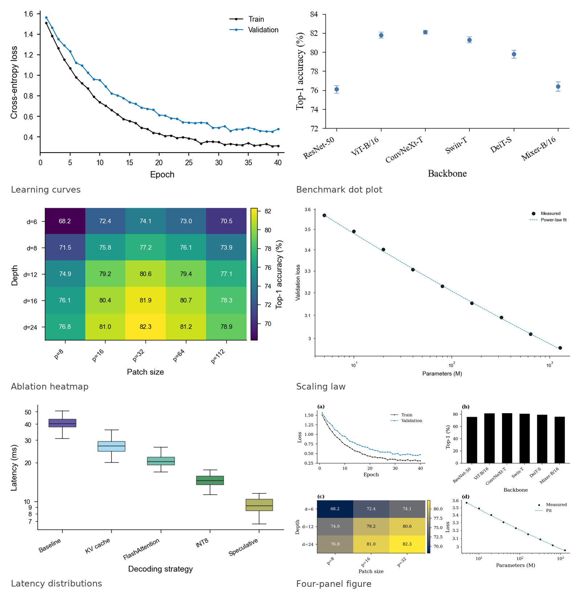

<div align="center">



# figspec

**把图当代码来管：声明式、合规、可复现的科研绘图工具链。**

[](https://github.com/figspec/figspec/actions/workflows/ci.yml)
[](pyproject.toml)
[](LICENSE)

</div>

---

figspec 用一份很小的 YAML 文件编译出可直接投稿的图。它知道 Nature 单栏是
3.504 英寸、5 pt 的字在最终尺寸下还能不能看清、哪两种颜色在红绿色盲眼里会
糊成一片——这些不必每投一篇论文就重学一遍。

```bash
pip install figspec
figspec init my-paper && figspec render my-paper/figure.yaml -o figures
```

生成 `figures/figure.pdf`、`figure.svg`、`figure.png`，并附一份可校验的
溯源清单。

## 为什么需要它

图是构建产物，但多数实验室把它当成“某个人手工调好的文件”。于是：

- 每家期刊的栏宽、字号、DPI 都不同，这些数字躺在没人读的投稿指南里，直到返修；
- 重跑 notebook 时 matplotlib 默认值变了，“同一张图”其实不是同一个文件；
- 配色在色盲读者眼里、或在黑白打印时悄悄失效；
- 半年后没人说得清哪份 CSV 画出了哪个子图。

figspec 把这些问题当成工程问题处理：一个 schema、一个编译器、一个 linter、
一份清单。

## 特性

- **声明式规格**：尺寸、坐标轴、数据系列、图例、注释、多子图布局都写在一个
  YAML 里，可 diff、可评审、可由脚本生成。
- **期刊预设**：内置 Nature、Science、Cell、IEEE、ACM、Elsevier、Springer、
  PLOS 八套；也可用 `--journal-file` 加载自定义预设。
- **合规检查**：18 条规则覆盖最终尺寸下的字号、线宽、色彩对比度（WCAG 2.1）、
  色盲可分辨性（在模拟二色视觉上计算 CIEDE2000）、DPI、图例与坐标轴标签、
  彩虹色图、截断的柱状图坐标轴。
- **可复现输出**：同一环境下 PDF/SVG/PNG/EPS 逐字节一致，时间戳与随机 id
  会被剥离。
- **溯源清单**：记录输入哈希、依赖版本、规格哈希、输出哈希与 git 状态；
  `figspec verify` 检测漂移。
- **多子图**：共享坐标轴、`(a)`–`(d)` 标号、逐面板图例。
- **可接入 CI**：`figspec lint --format sarif` 与 `figspec render --strict`
  把图的质量变成构建闸门。
- **库优先**：CLI 只是带类型的 Python API 的一层薄壳。

## 安装

```bash
pip install figspec
```

从源码安装：

```bash
git clone https://github.com/figspec/figspec
cd figspec
pip install -e ".[dev]"
pytest
```

需要 Python 3.10+ 与 matplotlib 3.7+；不依赖 LaTeX、浏览器或网络。

## 快速开始

```bash
figspec init my-paper          # 生成 figure.yaml 与 data/loss.csv
figspec render my-paper/figure.yaml -o figures
figspec lint  my-paper/figure.yaml --journal nature
```

`render` 会打印产物、lint 摘要与清单路径：

```
  [ok] figure.pdf                23.1 KiB
  [ok] figure.svg                28.6 KiB
  [ok] figure.png               135.6 KiB
rendered 3 file(s) in 0.72s
lint: clean
provenance: figures/figure.figspec.json
```

## 规格格式

```yaml
version: 1

meta:
  title: 训练与验证损失
  tags: [deep-learning, training]

figure:
  journal: nature        # 栏宽、字体、DPI、最小字号都来自这里
  layout: single         # single | 1.5 | double | custom
  formats: [pdf, svg, png]

style:
  palette: okabe-ito     # 色盲友好，前五种颜色对比度均 ≥ 3:1
  grid: true

axes:
  x: {label: Epoch, limits: [0, 41]}
  y: {label: Cross-entropy loss}

series:
  - type: line
    data: data/loss.csv
    x: epoch
    y: [train, val]
    labels: [Train, Validation]
    marker: o
    markersize: 2.2
```

系列类型：`line`、`scatter`、`bar`、`box`、`errorbar`、`area`、`heatmap`。
数据可来自 CSV、TSV、JSON、`.npy`/`.npz`，也可以直接内联。

完整字段（含多子图、注释、误差带、对数轴、色标）见
[docs/spec-reference.md](docs/spec-reference.md)。

## 合规检查

```bash
figspec lint figure.yaml --journal nature
```

```
figure.yaml: 1 error(s), 1 warning(s), 0 note(s)
  ERROR   FS001 2 text elements render at 4.0 pt, below the 5.0 pt minimum
          hint: raise font_size, shorten tick labels, or drop the label 'validation split'
  WARNING DA003 panel 0 bars start at 50 instead of zero
          hint: set the y limit to 0, or switch the series to 'errorbar'
```

规则共 18 条（FS001–FS004、CO001–CO004、ST001–ST007、DA001–DA003），
分级为 error / warning / info，`--format json|sarif` 供工具消费，
`--ignore 'CO*'` 可按通配符静音。

## 可复现性

```bash
figspec render figure.yaml -o out
figspec verify out/figure.figspec.json
```

清单记录：规格哈希与文件哈希、每个数据文件的大小与 SHA-256、输出文件的
SHA-256 与 DPI、Python/figspec/matplotlib/numpy/PyYAML 版本、git 提交与
是否 dirty、lint 摘要。任一输入、输出或规格变化，`verify` 都会以非零退出码
指出不一致项。设置 `SOURCE_DATE_EPOCH` 可固定清单时间戳。

## CLI

```
figspec init [DIR]                 生成规格与示例数据
figspec render SPEC [-o DIR]       构建 PDF/SVG/PNG/EPS
figspec lint SPEC                  合规与可访问性检查
figspec verify MANIFEST            校验清单是否漂移
figspec gallery SOURCES [-o DIR]   渲染为静态 HTML 图库
figspec journals                   列出期刊预设
figspec palettes                   列出配色
figspec rules                      列出 lint 规则
figspec doctor                     环境自检
```

## Python API

```python
import figspec

outcome = figspec.render("figure.yaml", "out/", journal="nature", strict=True)
print(outcome.report.to_text())
for output in outcome.outputs:
    print(output.path, output.sha256[:12])
outcome.close()
```

## 与同类工具的关系

| | figspec | 期刊样式包（如 SciencePlots） | Vega-Lite / ggplot | notebook + DVC |
|---|---|---|---|---|
| 声明式规格 | ✅ | ❌ | ✅ | ❌ |
| 期刊合规检查 | ✅ | ❌ | ❌ | ❌ |
| 色盲可分辨性审计 | ✅ | ❌ | ❌ | ❌ |
| 逐字节可复现 | ✅ | ❌ | 部分 | ❌ |
| 溯源清单 | ✅ | ❌ | ❌ | ✅（仅数据） |
| 投稿级 PDF/SVG | ✅ | ✅ | 部分 | ✅ |

figspec 有意做得窄：只产出论文插图，不做仪表盘；渲染引擎仍然是 matplotlib，
而不是把它藏起来。

## 项目状态

当前 **v0.1.0**：规格、渲染、lint、清单与 CLI 均可用，138 个测试覆盖核心路径；
v1.0 之前公开 API 仍可能在小版本间调整。

路线图：LaTeX 表格导出、violin/contour 图元、Jupyter magic、可复用的 GitHub
Action、第三方 lint 规则与图元插件机制。

## 参与贡献

最合适的第一份 PR 是新增一套期刊预设（一个 YAML 文件）或一条 lint 规则
（一个函数）。见 [CONTRIBUTING.md](CONTRIBUTING.md)。

## 引用与许可

引用信息见 [CITATION.cff](CITATION.cff)；许可证为 MIT，见 [LICENSE](LICENSE)。
