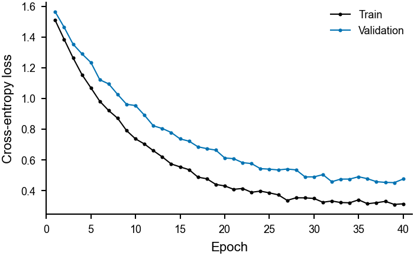
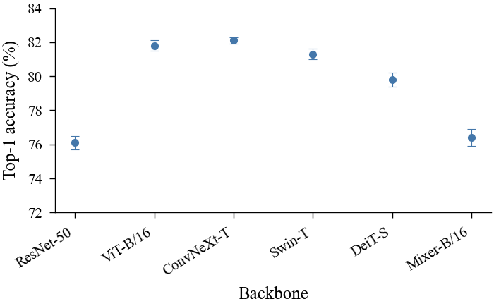
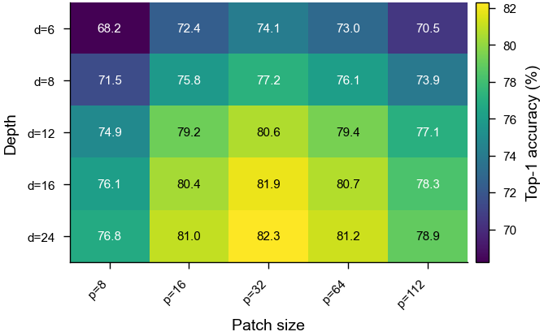
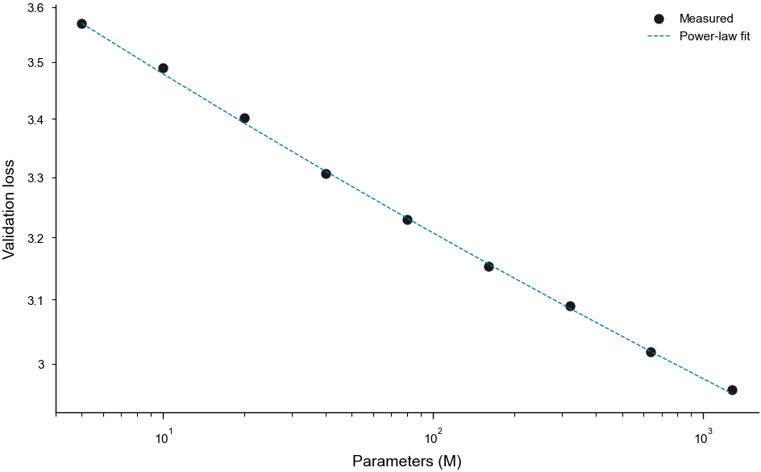
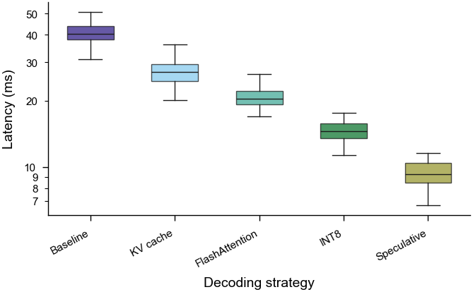
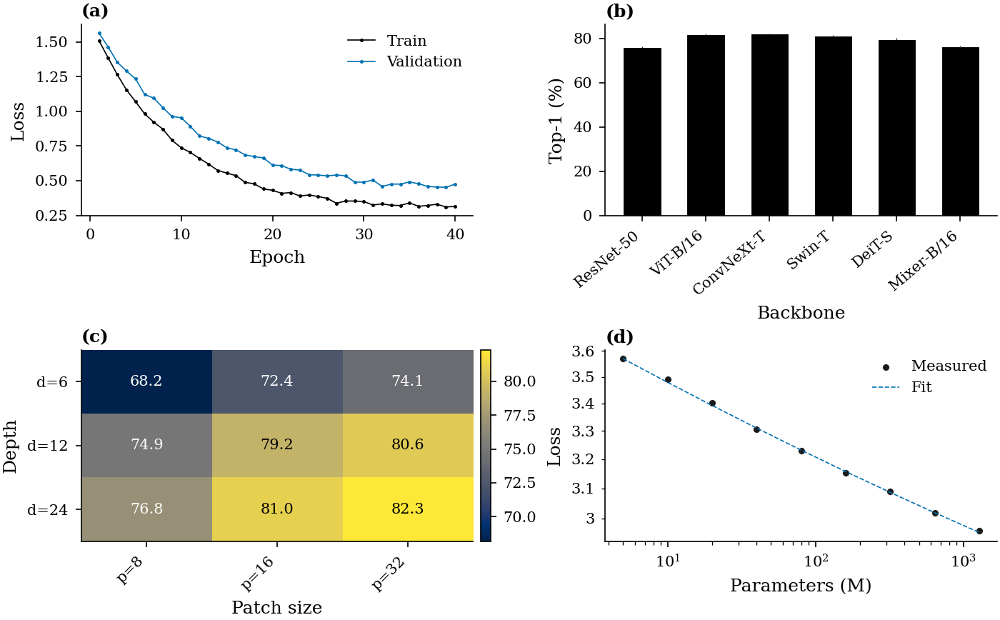

# Gallery

Six figures, each rendered by `figspec render` from the spec next to it and each
passing `figspec lint` against its target journal preset. No image here was
touched up by hand.

## Training and validation loss

[](https://github.com/sw176267788/FigSpec/blob/main/examples/01-learning-curves.yaml)

Two CSV columns become two lines; the legend labels come from the `y` columns.
Target: Nature, single column (3.504 in).

## Benchmark accuracy as a dot plot

[](https://github.com/sw176267788/FigSpec/blob/main/examples/02-benchmark-accuracy.yaml)

Position encodes the value, so the axis can start at 72% without exaggerating
differences. Target: IEEE, single column, serif type.

## Ablation heatmap

[](https://github.com/sw176267788/FigSpec/blob/main/examples/03-ablation-heatmap.yaml)

An inline matrix with categorical labels on both axes, in-cell values with
automatic text contrast, and a colour bar carrying the unit.

## Scaling law

[](https://github.com/sw176267788/FigSpec/blob/main/examples/04-scaling-law.yaml)

Log–log axes with a scatter series and a fitted power law; narrow log axes get
plain decimal tick labels instead of `3.2 x 10^0`. Target: Science, 1.5 columns.

## Latency distributions

[](https://github.com/sw176267788/FigSpec/blob/main/examples/05-latency-box.yaml)

Tidy long-format data (`method,latency_ms`), box plots on a log y axis. Target:
Cell, single column.

## Four-panel summary

[](https://github.com/sw176267788/FigSpec/blob/main/examples/06-multi-panel.yaml)

An explicit 2×2 grid with panel letters, per-panel legends and a colour bar
inside one cell. Target: ACM, double column (7 in).

## Regenerating these images

```bash
python scripts/build_assets.py
```

The script renders the examples, rebuilds `assets/hero.png`, refreshes the
per-figure PNGs above and writes a browsable HTML gallery to `build/gallery/`.
