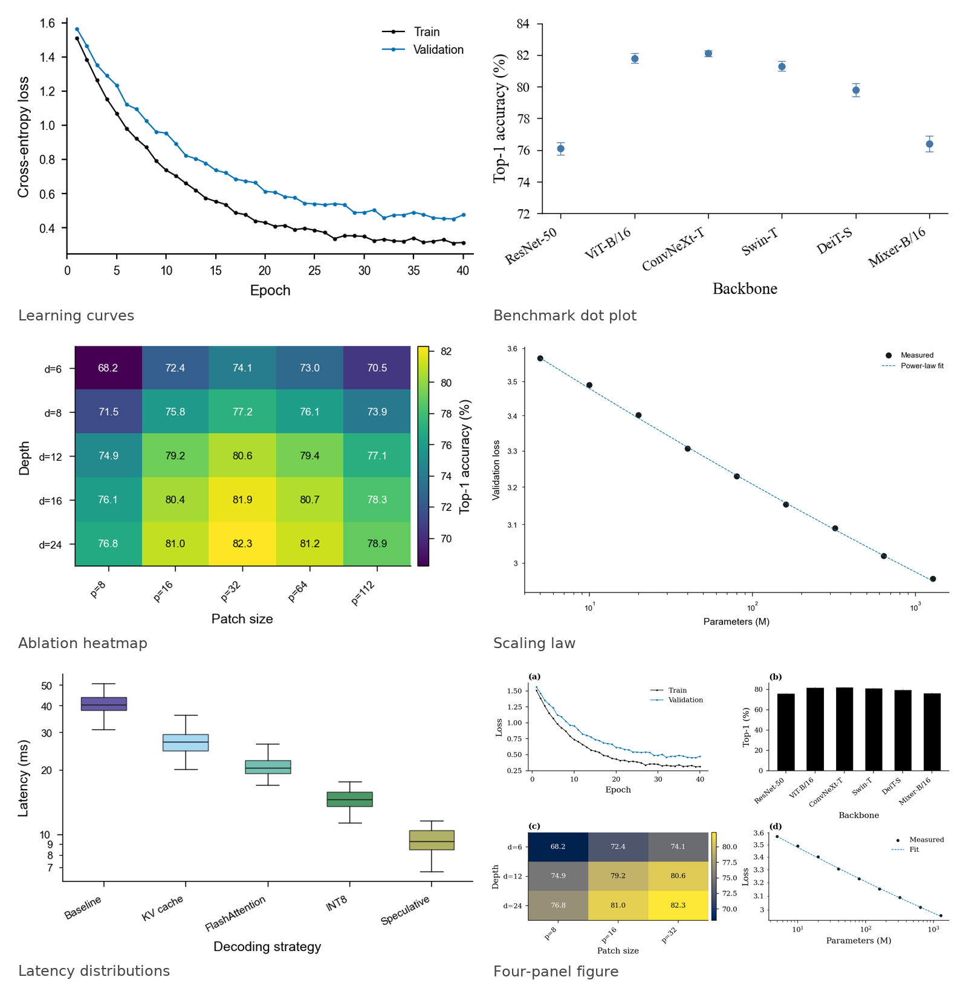

# figspec

**Figures as code: declarative, journal-compliant, reproducible.**

figspec turns a YAML description into publication-ready figures and tells you
when a figure would fail a journal's or a reader's expectations.

```bash
pip install "git+https://github.com/sw176267788/FigSpec.git"
figspec init my-paper
figspec render my-paper/figure.yaml -o figures
```

<div align="center">

</div>

## What it does

| Step | Command | Result |
|---|---|---|
| Describe | `figure.yaml` | A reviewable, diffable figure definition |
| Build | `figspec render` | PDF, SVG, PNG, EPS at the journal's exact width |
| Check | `figspec lint` | Typography, colour and data-integrity findings |
| Prove | `figspec verify` | Confirms inputs and outputs still match the manifest |

## Where to go next

- [Quickstart](quickstart.md) — from install to a compiled figure in two minutes.
- [Gallery](gallery.md) — six complete figures with their specs.
- [Spec reference](spec-reference.md) — every key, every default.
- [Journal presets](journals.md) — what each preset enforces and how to add one.
- [Lint rules](lint-rules.md) — the 18 checks and why they exist.
- [Provenance](provenance.md) — what a manifest records and how verification works.
- [CLI](cli.md) — commands, flags and exit codes.
- [Recipes](recipes.md) — common figure patterns, copy-paste ready.
- [FAQ](faq.md) — comparisons, fonts, notebooks and other loose ends.
